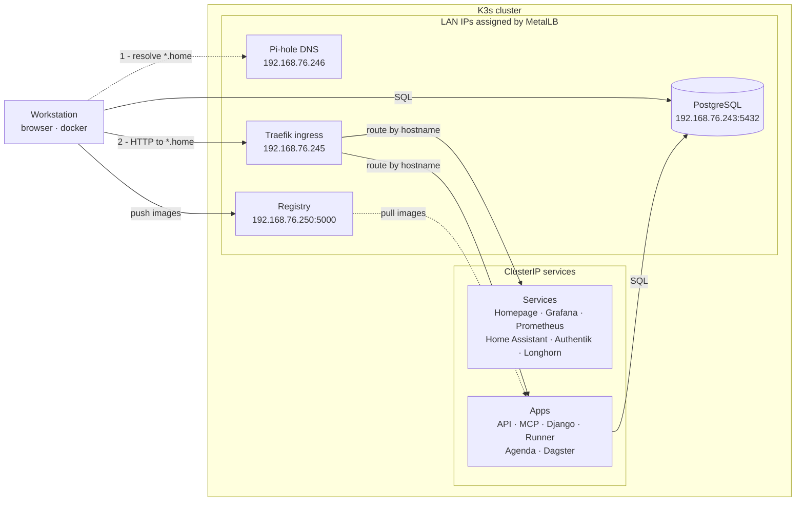

# Homelab

Personal Kubernetes homelab built on [K3s](https://k3s.io/) and managed with [Helmfile](https://github.com/helmfile/helmfile). Infrastructure, services, and self-hosted applications are declared in Git so the cluster can be maintained and extended from one place.

The project is primarily a platform for personal use, experimentation, and learning. It includes:

- Core infrastructure for networking (MetalLB, Traefik), storage (Longhorn), observability (Prometheus, Grafana, and Loki), and DNS (Pi-hole).
- Home Assistant as the central home-automation hub, with optional Zigbee and Thread support once the radio hardware is present.
- Custom applications in `apps/` for automation, personal workflows, and experimentation.

Repository organization:

- `services/` contains Helm values for third-party services deployed from upstream charts, plus the local PostgreSQL chart.
- `apps/` contains self-hosted applications and their source code.
- `charts/workload/` contains the shared Helm chart that serves as the golden path for deploying the in-house applications in `apps/`.

## Quick Start

**Prerequisites:** Linux system with `kubectl`, `helm`, and `helmfile` installed.

`make up` installs K3s, deploys the Helmfile releases, builds local app images, and points this workstation at the in-cluster Pi-hole DNS once it is ready. Browser-facing services use `.home` hostnames, which Pi-hole resolves to Traefik so requests can be routed to the right in-cluster service.

### Default Access

| Service        | Access                                                                                       | Credentials                                       |
| -------------- | -------------------------------------------------------------------------------------------- | ------------------------------------------------- |
| Homepage       | [apps.home](http://apps.home)                                                                | —                                                 |
| Grafana        | [grafana.home](http://grafana.home)                                                          | Authentik SSO (`auto_login`, login form disabled) |
| Prometheus     | [prometheus.home](http://prometheus.home)                                                    | —                                                 |
| Alertmanager   | [alertmanager.home](http://alertmanager.home)                                                | None                                              |
| Home Assistant | [homeassistant.home](http://homeassistant.home)                                              | Setup on first visit                              |
| Authentik      | [authentik.home](http://authentik.home)                                                      | Setup on first visit                              |
| Longhorn UI    | [longhorn.home](http://longhorn.home)                                                        | —                                                 |
| Pi-hole        | [pihole.home/admin/](http://pihole.home/admin/)                                              | admin / `pihole`                                  |
| Apps           | api.home, mcp.home, django.home, runner.home, agenda.home, dagster.home, workload-chart.home | —                                                 |
| PostgreSQL     | `192.168.76.243:5432` / in-cluster service                                                   | SOPS-managed postgres credentials                 |

Metrics, logs, dashboards, alerting, and runbooks are documented in [notes/services/monitoring.md](notes/services/monitoring.md).

## Services

Third-party services configured under `services/` and deployed by Helmfile.

| Service                                    | Description                                                    |
| ------------------------------------------ | -------------------------------------------------------------- |
| [MetalLB](services/metallb/)               | Manages static LAN IPs for Kubernetes services                 |
| [Traefik](services/traefik/)               | Ingress controller for browser-facing services                 |
| [Pi-hole](services/pihole/)                | DNS and `.home` records                                        |
| [Longhorn](services/longhorn/)             | Persistent storage for Kubernetes workloads                    |
| [Prometheus](services/prometheus/)         | Metrics and alert rules; Alertmanager routes alerts to Slack   |
| [Grafana](services/prometheus/)            | Dashboards for metrics and logs, bundled with Prometheus chart |
| [Loki](services/loki/)                     | Aggregates and stores logs from Kubernetes workloads           |
| [Alloy](services/alloy/)                   | DaemonSet that ships pod logs to Loki                          |
| [PostgreSQL](services/postgres/)           | Shared database for homelab-owned applications                 |
| [Registry](services/registry/)             | Local container registry for Docker images built from `apps/`  |
| [Authentik](services/authentik/)           | SSO / OIDC; Terraform-managed on `make up`                     |
| [Homepage](services/homepage/)             | Dashboard linking to browser-facing apps and services          |
| [Home Assistant](services/home-assistant/) | Home automation platform                                       |
| [Mosquitto](services/mosquitto/)           | MQTT broker for smart-home integrations                        |

Prepared but disabled until the hardware is present:

| Service                                                        | Description                                           |
| -------------------------------------------------------------- | ----------------------------------------------------- |
| [Zigbee2MQTT](services/zigbee2mqtt/)                           | Zigbee coordinator bridge; needs a Zigbee coordinator |
| [OpenThread Border Router](services/openthread-border-router/) | Thread border router; needs a Thread radio            |

## Apps

Self-hosted applications built from `apps/`, pushed to the local registry, and deployed with the `charts/workload` chart.

| App                                                    | Description                                                 |
| ------------------------------------------------------ | ----------------------------------------------------------- |
| [API](apps/api/)                                       | REST API app for custom workloads                           |
| [MCP](apps/mcp/)                                       | Private read-only MCP interface for homelab data and health |
| [Django](apps/django/)                                 | Database migration tool and admin interface                 |
| [Runner](apps/runner/)                                 | Internal UI for running approved app-owned jobs             |
| [Agenda](apps/agenda/)                                 | Next.js app for personal reminders and a daily agenda view  |
| [Dagster](apps/dagster/)                               | Orchestration for homelab data pipelines                    |
| [Workload Chart Example](apps/workload-chart-example/) | Deployed reference app using the workload chart             |

## Network Flow

Services are available at `*.home` URLs to any device on the LAN. Pi-hole resolves those names and Traefik forwards each request to the right service.

